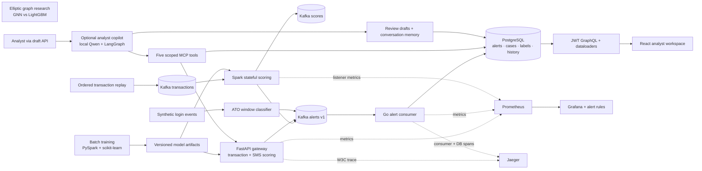
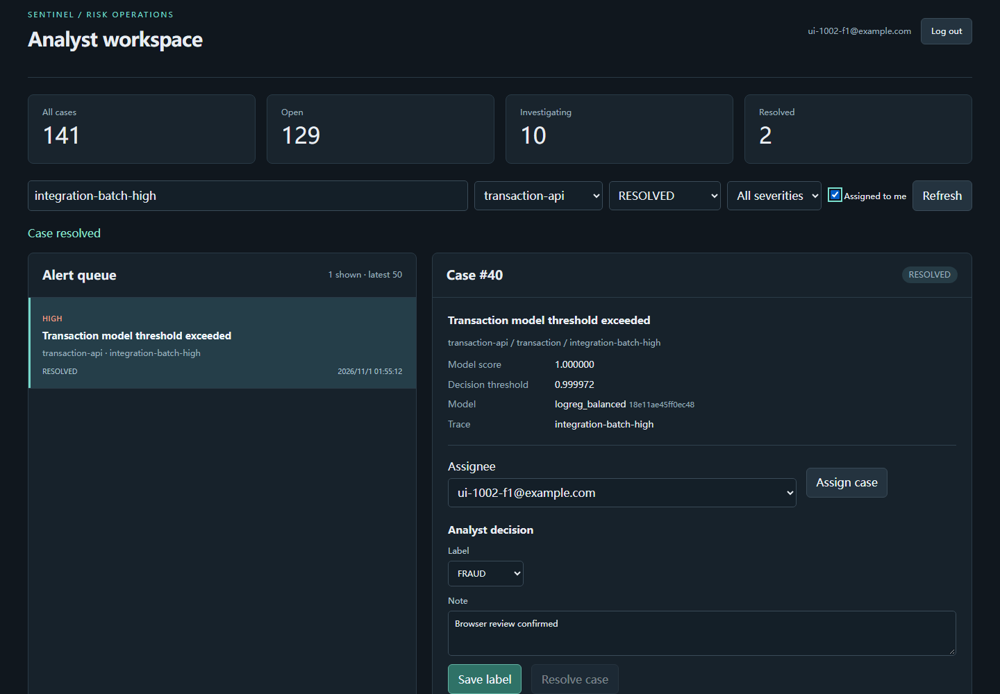

# Sentinel Risk Platform

I wanted one place to follow a risk signal from a model prediction to an analyst's decision. Sentinel joins a credit-card fraud model, a Spark transaction stream, an SMS classifier and a synthetic login-abuse detector with a shared alert contract and a small review workspace.

The interesting part was getting the boundaries right: the same feature order in Python and Scala, explicit score provenance, retries that do not create duplicate cases, and an audit trail behind each assignment, label and resolution.



## Run locally

With Docker Compose and Python 3 available, a fresh checkout includes the two fitted serving models and the exported Scala coefficients. Their hashes are checked before startup.

```bash
bash scripts/up.sh
# Console: http://localhost:13040
# Gateway: http://localhost:18040/docs

bash scripts/demo.sh
```

The demo uses a [bundled, SHA-256-checked prefix](gateway/fixtures/README.md) of 10,000 real, ordered, deduplicated credit-card transactions and runs the synthetic ATO classifier. It checks scores against Python, reconciles every unique alert with a case, then assigns, labels and resolves a case through GraphQL. Create an analyst account in the console to explore the same queue. The full OpenML downloader remains an explicit `--download-full` option with its upstream checksum checks.

The local stack has its own ports and named volumes. `HOST_NETWORK=1 bash scripts/up.sh` uses the Linux host-network override for an engine with bridge networking disabled. Generated credentials and downloaded data stay in ignored local files.

Containers write to ignored `.runtime/results/`. After the demo's checks pass, the host runner collects the evidence into `results/`, so reruns can update a fresh checkout's recorded results while the services remain non-root.

I also added an [optional operations setup](ops/README.md) to follow a request across the gateway, Kafka and Postgres. `OPS_BUILD=1 bash ops/scripts/up.sh` starts its separate Compose project with Prometheus, Grafana and Jaeger. The [Helm chart](deploy/helm/sentinel/README.md) exercises updates, rollback and pod recovery on local/CI kind; the [runbook](ops/RUNBOOK.md) covers a database outage. These runners write new evidence under `results/ops/` and refuse to replace an existing run.

## What the models found

| Experiment | Result | Evidence |
|---|---:|---|
| Credit-card logistic regression, later holdout | PR-AUC **0.728** | [raw batch metrics](results/model-quality/batch.json) |
| SMS TF-IDF + LR, paired 400-message evaluation | F1 **0.9388** | [paired metrics](results/model-quality/sms-qwen15.json) |
| SMS TF-IDF + LR, full 1,035-message test set | F1 **0.9575** | [November 2 comparison](text-risk/results/qlora/20261102-5465aae5/comparison/summary.json) |
| SMS QLoRA, same full test set, three training seeds | F1 **0.9783 ± 0.0034** | [training and evaluation](text-risk/results/qlora/20261102-5465aae5/RESULTS.md) |
| Hybrid SMS routing to Qwen 0.5B / 1.5B, same messages | F1 **0.8190 / 0.8491** | [0.5B](results/model-quality/sms-qwen05.json), [1.5B](results/model-quality/sms-qwen15.json) |
| Elliptic, all 165 features, new three-seed GraphSAGE / GAT run | PR-AUC **0.559 / 0.407** | [fresh graph metrics](results/model-quality/graph.json) |
| Elliptic, same split/features, three-seed LightGBM | PR-AUC **0.793** | [full graph metrics](results/model-quality/graph.json) |

The small LLM hybrids did not improve F1 over TF-IDF on these paired SMS messages, so Compose serves TF-IDF by default. The GNNs also did not beat LightGBM on this fixed-graph protocol. The graph study uses a temporal label split on the full graph, with train-only preprocessing and validation-only threshold selection; its full feature set already contains neighborhood aggregates.

The separate QLoRA experiment improved the SMS point estimates. Its three-seed spread above is a population standard deviation; paired test-message intervals include or touch zero for the gains over TF-IDF. TF-IDF remains the default, with measured p50 latency of 0.901 ms versus 472–486 ms for the adapters. The [module report](text-risk/README.md) keeps strict-format failures, rules fallback and a separate posthoc format check visible.

The batch and paired SMS evaluations are retained source measurements; the [quality manifest](results/model-quality/manifest.json) records their original paths and SHA-256 hashes. The graph module was trained again after integration on the RTX 3080: both feature sets, three seeds, up to 300 epochs with patience 40, and 26 individual fit records. Its trainer timer was 531.0 seconds; model fit-plus-score times and resource snapshots accompany the results.

## Integration and console measurements

The [Compose run](results/integration/summary.json) scored all 10,000 replayed transactions, with no missing or duplicate scores. Python and Spark differed by at most **1.29 × 10⁻¹⁴**, and all 10,000 threshold decisions matched. The terminal Spark batch covered the flush marker before the runner drained the Kafka high-water offset.

The four producers delivered **141 unique alerts and cases**: 38 streaming transactions, two API predictions, one SMS and 100 synthetic ATO windows. A deliberately repeated alert made 142 Kafka records; the consumer committed that offset while keeping one case and its four-event audit trail. [Raw scores, independent references and offsets](results/integration/) accompany the summary.

The final proxy configuration ran in [CI 41306587753](https://github.com/kianbqh/sentinel-risk-platform/actions/runs/41306587753), on a GitHub-hosted Linux runner with a Xeon Platinum 8573C, four logical CPUs and 15.6 GiB RAM. Reads return 50 cases with labels and complete histories. Writes update ten independent cases twenty times each; all 200 new audit events were read back with the expected actor and note.

| Operation | Concurrency | Valid / attempted | Batch wall | Valid requests/s | P95 | P99 |
|---|---:|---:|---:|---:|---:|---:|
| Read queue and histories | 1 | 200 / 200 | 1.064 s | 188.0 | 6.9 ms | 7.9 ms |
| Read queue and histories | 20 | 1,000 / 1,000 | 2.569 s | 389.2 | 98.4 ms | 133.8 ms |
| Write case labels | 10 | 200 / 200 | 0.258 s | 776.4 | 19.5 ms | 23.1 ms |

These are bounded request batches. Each read phase excludes ten warm-up requests; setup assignments and persisted-history readback sit outside the write timer. Every measured response body was checked. [Per-request latencies, environment and source hashes](results/load/ci-dbd3069/summary.json) identify source `dbd3069`; the [earlier WSL measurement](results/load/summary.json) retains the original proxy configuration's results. The [browser check](results/ui/summary.json) also followed account creation, filtering, assignment, labeling and resolution through the interface, with no browser-console errors.



The [security reports and triage](results/security/TRIAGE.md) retain the observations as well as the passing gates: Semgrep had no findings; Bandit flagged one medium-severity fixed-URL downloader call; Trivy retained one UNKNOWN, unfixed Go advisory and no secrets. Both authenticated ZAP scans reported **0 high, 0 medium, 4 low and 5 informational alert types**. The full scan used a five-minute active limit; the runner accounted for all 80,028 active responses, with no observed HTTP502 or nginx upstream address-exhaustion errors. Earlier findings and the connection-reuse fix remain in the [scan history](results/security/history/README.md).

## Watching failures and recovery

I added metrics and tracing, then stopped the database and updated the application under load. The [operations report](results/M1B_DELIVERY_REPORT.md) keeps the failed attempts alongside the fixes, with separate local and CI measurements.

| Check | Observed result | Evidence |
|---|---|---|
| Local Prometheus / Grafana | 3 scraped endpoints; 8 dashboard panels checked | [service checks](results/ops/local/smoke.json) |
| Alert rules | 9 test groups; 15 assertions passed | [rule tests](results/ops/local/static.json) |
| Gateway → Kafka → consumer → database | 4 spans with verified parent relationships | [local trace](results/ops/local/trace.json) |
| Local database outage and recovery | 21 Kafka records; 20 unique cases; 0 duplicate cases | [offsets and recovery timeline](results/ops/local/drill-db-outage.json) |
| Local rolling update, rollback and pod recovery | 10919 requests; 9943 overlapping the update; 0 failures; rollback and recovery passed | [raw local kind run](results/ops/local/kind-lifecycle.json) |
| CI rolling update after termination draining | 2815 requests; 2561 overlapping the update; 0 failures | [raw kind run](results/ops/ci-d2a66ce38d6e1d7caf343924e2a0295632ecee7f/kind-lifecycle.json) |

An earlier update had [36 connection failures](results/ops/ci-67b2cb9c341c18722412cb7c32df626313bf9a9a/kind-lifecycle.json). I kept those samples and added an exit delay so endpoint updates can reach clients before the process stops. These are bounded single-node kind runs. The [Helm chart](deploy/helm/sentinel/README.md), [Bash commands](ops/README.md) and [database runbook](ops/RUNBOOK.md) reproduce the exercises; AWS remains validation-only.

## Following a signal

All producers use [alert v1](contracts/README.md). An alert has a stable ID, source, entity, model version, evidence and trace ID. Numeric models attach a probability and decision threshold. An LLM label can have no probability; hybrid text routing identifies its TF-IDF probability separately from the label decision.

The consumer writes an alert, its initial case and its ingestion event in one database transaction, then commits the Kafka offset. Repeated alert IDs return the existing case. Analysts share the queue and can filter by source, status, severity, assignee or text, assign a case, record a label, and resolve it. JWTs stay in browser memory; case events and labels use request-scoped dataloaders.

The ATO data is entirely synthetic. Its supervised signal classifies completed IP-hour windows; the separate sliding-window throttle remains a live rule component. Synthetic evaluation metrics describe this generator, including its benign NAT traffic and held-out low-and-slow campaign.

## Modules and checks

| Module | Data / purpose | Results |
|---|---|---|
| [batch](batch/README.md) | OpenML 1597 feature pipeline and model selection | [quality metrics](results/model-quality/batch.json) |
| [streaming](streaming/README.md) | Ordered credit-card replay, inclusive trailing-hour state | `results/integration/`, `results/streaming/` |
| [gateway](gateway/README.md) | Shared transaction and SMS inference API | `results/integration/` |
| [text-risk](text-risk/README.md) | UCI SMS Spam Collection; TF-IDF, rules and local LLM routing | `text-risk/results/` |
| [ato](ato/README.md) | Synthetic login abuse | `results/integration/ato-publish.json` |
| [console](console/README.md) | Shared analyst cases and audit history | `results/tests/`, `results/load/` |
| [graph research](research/graph/README.md) | Elliptic, all/local features, temporal labels on a fixed graph | `research/graph/results/` |
| [security](security/README.md) | Service scans and intentionally vulnerable test fixtures | `results/security/` |
| [deployment](deploy/README.md) | Kubernetes and AWS Terraform recipes | formatting and validation only |
| [operations](ops/README.md) | Service metrics, traces, readiness, database outage and single-node kind | new runs under `results/ops/` |
| [analyst copilot](copilot/README.md) | Repository-derived transaction cases and synthetic login windows; MCP tools, retrieval and review drafts | `copilot/results/` |

The [single root workflow](.github/workflows/platform.yml) runs Python, real-PostgreSQL Go integration/race tests, frontend interactions/build, Scala parity/state tests, graph unit tests, Terraform validation, service scans and the Compose flow. Console load runners validate every GraphQL body and retain per-request read/write latencies. The bounded console ZAP scan includes authenticated GraphQL exploration on the owned localhost origin.

Three additional jobs validate the operations scripts and alert rules, check the instrumented Compose flow, and exercise the Helm lifecycle under load in kind. AWS Terraform remains validation-only.

Each imported source history remains reachable through unsquashed subtree merges. [History imports](results/history-imports.json) records the source commits and exact commands.
