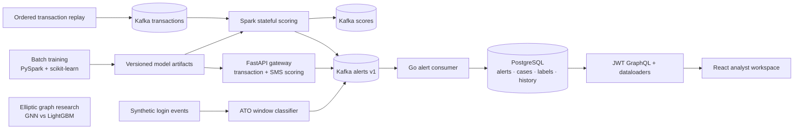

# Sentinel Risk Platform

I wanted one place to follow a risk signal from a model prediction to an analyst's decision. Sentinel joins a credit-card fraud model, a Spark transaction stream, an SMS classifier and a synthetic login-abuse detector with a shared alert contract and a small review workspace.

The interesting part was getting the boundaries right: the same feature order in Python and Scala, explicit score provenance, retries that do not create duplicate cases, and an audit trail behind each assignment, label and resolution.



## Run locally

With Docker Compose and Python 3 available, a fresh checkout includes the two fitted serving models and the exported Scala coefficients. Their hashes are checked before startup.

```bash
bash scripts/up.sh
# Console: http://localhost:13040
# Gateway: http://localhost:18040/docs

bash scripts/demo.sh
```

The demo downloads OpenML's credit-card data when it is not cached, replays the first 10,000 ordered, deduplicated transactions, and runs the synthetic ATO classifier. It checks scores against Python, reconciles every unique alert with a case, then assigns, labels and resolves a case through GraphQL. Create an analyst account in the console to explore the same queue.

The local stack has its own ports and named volumes. `HOST_NETWORK=1 bash scripts/up.sh` uses the Linux host-network override for an engine with bridge networking disabled. Generated credentials and downloaded data stay in ignored local files.

## What the models found

| Experiment | Result | Evidence |
|---|---:|---|
| Credit-card logistic regression, later holdout | PR-AUC **0.728** | [raw batch metrics](results/model-quality/batch.json) |
| SMS TF-IDF + LR, paired 400-message evaluation | F1 **0.9388** | [paired metrics](results/model-quality/sms-qwen15.json) |
| Hybrid SMS routing to Qwen 0.5B / 1.5B, same messages | F1 **0.8190 / 0.8491** | [0.5B](results/model-quality/sms-qwen05.json), [1.5B](results/model-quality/sms-qwen15.json) |
| Elliptic, all 165 features, new three-seed GraphSAGE / GAT run | PR-AUC **0.559 / 0.407** | [fresh graph metrics](results/model-quality/graph.json) |
| Elliptic, same split/features, three-seed LightGBM | PR-AUC **0.793** | [full graph metrics](results/model-quality/graph.json) |

The small LLM hybrids did not improve F1 over TF-IDF on these paired SMS messages, so Compose serves TF-IDF by default. The GNNs also did not beat LightGBM on this fixed-graph protocol. The graph study uses a temporal label split on the full graph, with train-only preprocessing and validation-only threshold selection; its full feature set already contains neighborhood aggregates.

The batch and paired SMS evaluations are retained source measurements; the [quality manifest](results/model-quality/manifest.json) records their original paths and SHA-256 hashes. The graph module was trained again after integration on the RTX 3080: both feature sets, three seeds, up to 300 epochs with patience 40, and 26 individual fit records. Its trainer timer was 531.0 seconds; model fit-plus-score times and resource snapshots accompany the results.

## Following a signal

All producers use [alert v1](contracts/README.md). An alert has a stable ID, source, entity, model version, evidence and trace ID. Numeric models attach a probability and decision threshold. An LLM label can have no probability; hybrid text routing identifies its TF-IDF probability separately from the label decision.

The consumer writes an alert, its initial case and its ingestion event in one database transaction, then commits the Kafka offset. Repeated alert IDs return the existing case. Analysts share the queue and can filter by source, status, severity, assignee or text, assign a case, record a label, and resolve it. JWTs stay in browser memory; case events and labels use request-scoped dataloaders.

The ATO data is entirely synthetic. Its supervised signal classifies completed IP-hour windows; the separate sliding-window throttle remains a live rule component. Synthetic evaluation metrics describe this generator, including its benign NAT traffic and held-out low-and-slow campaign.

## Modules and checks

| Module | Data / purpose | Results |
|---|---|---|
| [batch](batch/README.md) | OpenML 1597 feature pipeline and model selection | [quality metrics](results/model-quality/batch.json) |
| [streaming](streaming/README.md) | Ordered credit-card replay, inclusive trailing-hour state | `results/integration/`, `results/streaming/` |
| [gateway](gateway/README.md) | Shared transaction and SMS inference API | `results/integration/` |
| [text-risk](text-risk/README.md) | UCI SMS Spam Collection; TF-IDF, rules and local LLM routing | `text-risk/results/` |
| [ato](ato/README.md) | Synthetic login abuse | `results/integration/ato-publish.json` |
| [console](console/README.md) | Shared analyst cases and audit history | `results/tests/`, `results/load/` |
| [graph research](research/graph/README.md) | Elliptic, all/local features, temporal labels on a fixed graph | `research/graph/results/` |
| [security](security/README.md) | Service scans and intentionally vulnerable test fixtures | `results/security/` |
| [deployment](deploy/README.md) | Kubernetes and AWS Terraform recipes | formatting and validation only |

The [single root workflow](.github/workflows/platform.yml) runs Python, real-PostgreSQL Go integration/race tests, frontend interactions/build, Scala parity/state tests, graph unit tests, Terraform validation, service scans and the Compose flow. Console load runners validate every GraphQL body and retain per-request read/write latencies. The bounded console ZAP scan includes authenticated GraphQL exploration on the owned localhost origin.

Each imported source history remains reachable through unsquashed subtree merges. [History imports](results/history-imports.json) records the source commits and exact commands.
