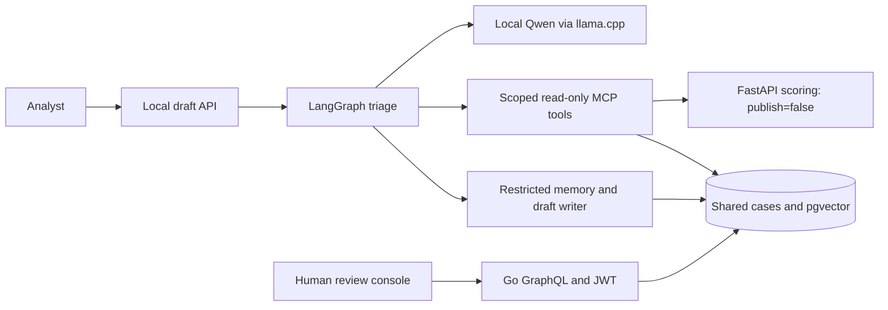

# Analyst copilot

I wanted a way to ask follow-up questions about a case without turning a model
into another decision maker. This module reads the same cases as the analyst
console, gathers evidence through five MCP tools, and saves a draft for review.
The analyst still assigns, labels and resolves the case.

The optional Compose stack gives the console, gateway and copilot one new
PostgreSQL database with pgvector. The original platform stack keeps its own
database. Drafts appear as `COPILOT_DRAFT` case events and are also returned by
the authenticated API; there is no separate copilot console panel.

- [Tools, database setup and retrieval](README-tools.md)
- [Agent, fixed cases and evaluation](README-agent.md)
- [Separate SMS QLoRA experiment](../text-risk/finetune/README.md)

The two model tasks are separate. The analyst agent uses a local GGUF model to
choose tools and draft summaries. QLoRA trains a binary SMS classifier on the
original training split. TF-IDF remains the served SMS classifier.

## Data and reproduction

The case fixtures combine the bundled real credit-card transactions with
explicitly synthetic login-abuse windows. The fixed agent protocol records
source IDs, expected tool calls and facts before model evaluation. Retrieval
uses a separate balanced query/gallery split and excludes labels, predicted
scores, identifiers and campaign names from embedding text.

Follow the tools setup first: create local credentials, start PostgreSQL and
the Go backend, apply the additional migration, provision restricted roles,
then start the gateway, console and MCP server. The agent guide covers the
local llama.cpp process, draft API and evaluation commands. Each runner takes
a JSON configuration and creates a new result directory. Use the exact model
revisions and dependency snapshots recorded alongside a measured run.

The [local tool run](results/functional-dcb8436-01/checks/result.json) passed
24 checks with real HTTP and PostgreSQL enabled; the
[GitHub-hosted tool run](results/ci-tools-5465aae-01/checks/result.json) passed
26. On a separate balanced 32-query/64-gallery fixture,
[CPU BGE + pgvector](results/retrieval-dcb8436-01/benchmark/result.json)
reached P@5 of 0.75625, versus 0.5625 for gallery-fit TF-IDF and 0.46875 for
fixed random. The [controlled draft and human-review check](results/functional-dcb8436-01/human-review/result.json)
used the same database as the console and preserved the draft after analyst
labeling and resolution.

[49 CPU agent checks](results/recording-unit-20261102/tests.log) passed with
synthetic model boundaries. The 120-case actual-MCP protocol is frozen, but
real-Qwen quality, latency, the live draft API and actual-model cassette replay
remain pending. Recorded-response CI replay is prepared and does not load an
LLM on the GitHub-hosted runner.

## Limitations

This is a local small-model experiment on repository-derived cases. The
faithfulness check matches literal numbers and identifiers; it does not prove
that a summary's interpretation is correct. Login events are synthetic. The
retrieval benchmark uses an exact cosine scan over a bounded fixture, and
does not establish large-index serving performance. Model confidence is a
self-reported field, not a calibrated probability.
