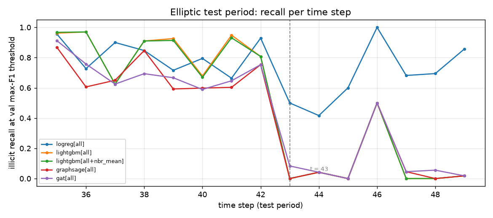

# Graph context for illicit-transaction detection

I compared logistic regression, LightGBM, GraphSAGE and GAT on Elliptic. The graph models did not beat LightGBM here, which makes the feature and protocol details as interesting as the architectures.

The dataset has203,769 nodes and234,355 raw directed edges. It offers165 features:93 local transaction features and72 neighborhood aggregates. Both the full165 and local93 feature sets are evaluated. Unknown labels participate in message passing but never in supervised loss or evaluation.

The protocol is a temporal label split on a **fixed full graph**, so message passing can see future nodes/edges. Scalers fit training rows only; validation labels choose the max-F1 threshold and the precision-target selector. The latter falls back to the maximum-achieved-precision threshold if90% validation precision is unattainable. Every seed records its actual threshold, achieved precision and `target_met` flag; test precision at that threshold can differ again.

After the subtree import, the full run was repeated on the RTX3080 with seeds0,1,2, both feature sets, max300 epochs and patience40. Logistic regression uses one seed per feature set; the other four variants use three, giving26 separate fit records. LR/LightGBM run on CPU; GraphSAGE/GAT run on CUDA. Per-fit elapsed time includes final scoring and excludes the earlier neighbor-mean construction.

| Full165 features | Mean test PR-AUC |
|---|---:|
| LightGBM |0.793|
| GraphSAGE |0.559|
| GAT |0.407|

The complete mean/population-standard-deviation table, local-feature results, precision/recall selectors and timing values are in [results/table.md](results/table.md). [Per-seed JSON](results/per_seed/) retains all26 metrics, thresholds, epochs and CUDA peaks. The recorded trainer timer is531.0 seconds. Training-time hardware/process snapshots and provenance accompany these new outputs.



The curves show how a fixed validation threshold behaves across later timesteps. The vertical mark locates t43; it does not assign an external cause to a change in the curve.

```bash
pip install -r requirements.txt
DEVICE=cuda N_JOBS=4 LGBM_JOBS=1 python -u train.py --seeds 3 --epochs 300
python render_results.py  # redraws only stored curves
```

Data provenance and preparation are in `fraudgnn/data.py`; download/cache files are ignored. This research model is separate from the logistic-regression model serving the local analyst flow.
